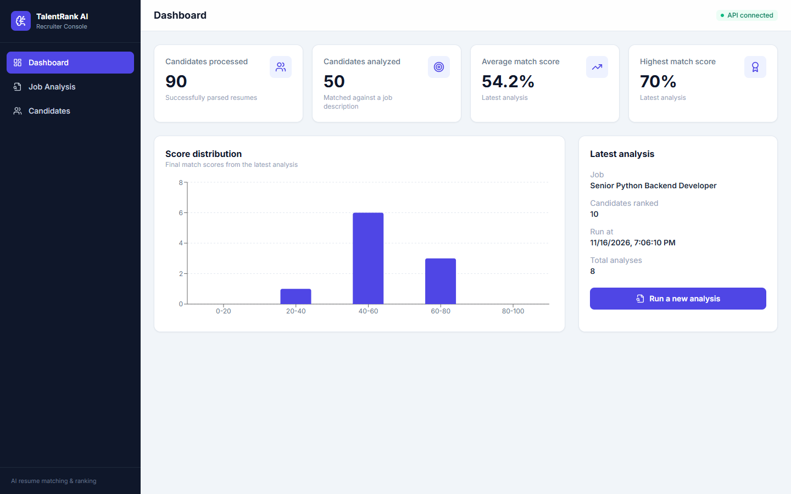
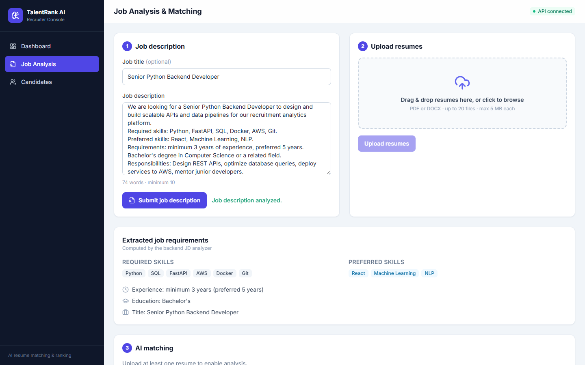
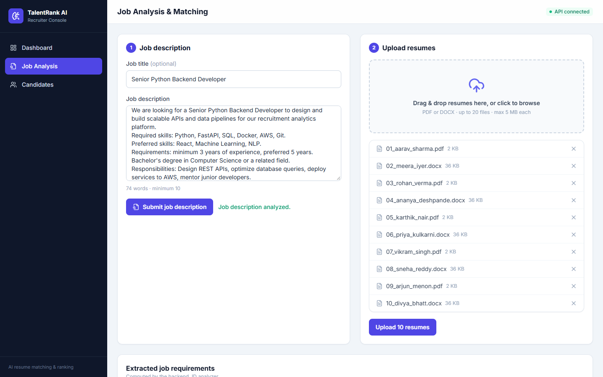
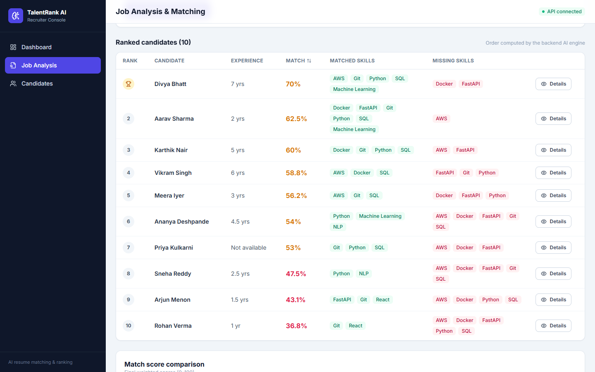
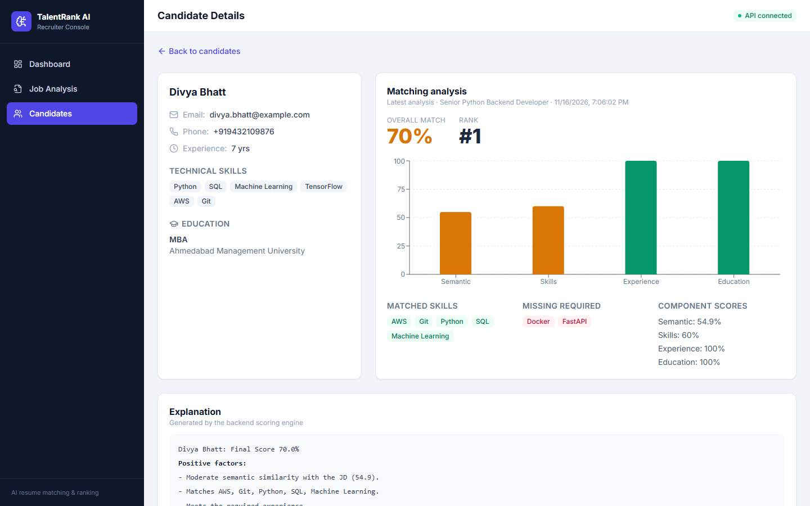
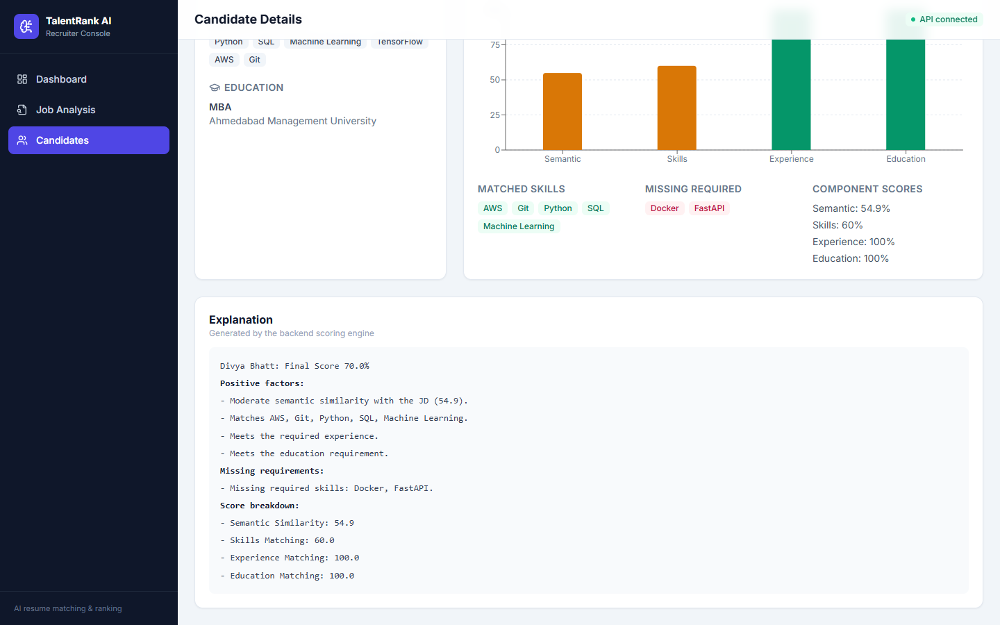

# TalentRank AI – AI-Based Resume Matching & Candidate Ranking System

An AI-powered recruitment analytics application that parses candidate resumes (PDF/DOCX),
analyzes a job description with NLP, and ranks candidates against the role using semantic
similarity, skills, experience and education matching — with a transparent, explainable
weighted score for every candidate.

Built as a four-day internship technical assessment: FastAPI backend (Day 1), local
Sentence-Transformers matching engine (Day 2), React recruiter dashboard (Day 3),
final testing, documentation and submission preparation (Day 4).

---

## 1. Project Overview

TalentRank AI helps a recruiter answer one question: *"Given this job description and these
resumes, who fits best, and why?"*

The recruiter pastes a job description, uploads a batch of resumes, and clicks
**Analyze**. The backend extracts structured requirements from the JD, extracts candidate
information from each resume, computes four matching components per candidate, combines
them into a weighted final score, and returns a deterministic ranking with a human-readable
explanation. The React dashboard displays all of it — nothing is computed or invented in
the frontend.

## 2. Problem Statement

Recruiters routinely compare dozens of resumes against a single job description. Manual
screening is slow, inconsistent and keyword-biased: a strong candidate who writes
"built REST services with FastAPI" may be skipped by a reviewer searching for the exact
phrase "API development". Different reviewers also weigh skills, experience and education
differently, and rarely document *why* a candidate was shortlisted or rejected.

TalentRank AI addresses this by:

- parsing resumes automatically (PDF and DOCX, bulk upload),
- comparing **meaning**, not just keywords, using sentence embeddings,
- applying one consistent, documented scoring policy to every candidate,
- producing per-candidate explanations (matched skills, missing skills, experience gap,
  education comparison, weight redistribution notes) so every ranking is auditable.

## 3. Key Features

Implemented and verified (see [Testing](#14-testing)):

- **Bulk resume upload** — up to 20 files per batch (PDF/DOCX), per-file error isolation:
  one corrupted file never fails the batch.
- **Resume parsing** — PyMuPDF for PDF, python-docx for DOCX; whitespace normalization;
  empty/corrupted/unsupported files rejected with clear messages; scanned (image-only)
  PDFs detected and reported honestly as "OCR not implemented".
- **Rule-based candidate extraction** — name, email, phone (Indian + international
  formats), technical skills (alias-normalized, case-insensitive, deduplicated),
  education (degree + institution), years of experience (`null` when not stated).
- **Structured JD analysis** — required vs preferred skills, minimum vs preferred
  experience, education requirement, responsibilities, job title. Nothing is invented:
  absent requirements stay absent.
- **Semantic matching** — local `sentence-transformers/all-MiniLM-L6-v2` embeddings
  (384-dim), cosine similarity scaled to 0–100. No paid API, no data leaves the machine.
- **Skills matching** — required skills weighted 2×, preferred 1×; alias normalization
  (e.g. `ml` → Machine Learning, `js` → JavaScript).
- **Experience & education matching** — partial credit below requirements, explicit
  neutral handling when candidate information is unknown (never a silent zero).
- **Weighted scoring with transparent missing-data policy** — 40/30/20/10 base weights,
  proportional redistribution when a component is unavailable, reported in the breakdown.
- **Deterministic ranking** — competition ranking (1, 2, 2, 4); ties broken by skills
  score, then semantic score, then candidate id. Never by personal attributes.
- **Explanations** — generated per candidate from the actual computed components.
- **Recruiter dashboard (React)** — dashboard statistics, JD analysis view, drag-and-drop
  bulk uploader with per-file status, ranked candidate table, candidate detail page with
  component-score chart, matched/missing skill badges, score distribution and comparison
  charts (Recharts), loading/error/empty states, backend-health indicator.
- **Persistence** — SQLite via SQLAlchemy; candidates and every analysis run are stored;
  the UI restores the last session (JD, uploaded candidates, ranking) after refresh.
- **Automated tests** — 75 pytest tests covering parsing, extraction, matching, scoring,
  ranking and all API endpoints.

## 4. Technology Stack

| Layer | Technology (actual versions in use) |
|---|---|
| Frontend | React 18.3.1, Vite 5.4.21, Tailwind CSS 3.4, Axios, React Router DOM 6.30, Recharts 2.15.4, Lucide React |
| Backend | Python 3.11, FastAPI 0.163.1, Uvicorn 0.54.0, Pydantic 2.14.3, python-multipart 0.0.34 |
| Parsing | PyMuPDF 2.1 (`pymupdf`), python-docx 1.2.0 |
| Database | SQLite + SQLAlchemy 2.1.8 |
| AI / NLP | sentence-transformers 6.3.0 (`all-MiniLM-L6-v2`), torch 2.15.0+cpu, scikit-learn 1.9.1 (cosine similarity), transformers 5.23.0 |
| Testing | pytest 9.2.0, httpx 0.28.1 (FastAPI TestClient) |

The embedding model runs **locally on CPU**. It is downloaded once from Hugging Face
(~90 MB) on first use and cached; no cloud AI service or API key is required.

## 5. System Architecture

```
┌────────────────────────────┐        HTTP/JSON (Axios)        ┌─────────────────────────────────┐
│  React SPA (Vite, :5173)   │ ──────────────────────────────► │  FastAPI (Uvicorn, :8000)       │
│                            │                                 │                                 │
│  Dashboard / JobAnalysis   │                                 │  routes/                        │
│  Candidates / Details      │                                 │   resume · jobs · matching      │
│  AppContext + localStorage │                                 │   candidates · stats            │
│  Recharts visualizations   │                                 │        │                        │
└────────────────────────────┘                                 │        ▼                        │
                                                               │  services/                      │
                                                               │   resume_parser (PDF/DOCX)      │
                                                               │   candidate_extractor (rules)   │
                                                               │   jd_analyzer (rules)           │
                                                               │   embedding_service (MiniLM)    │
                                                               │   semantic / skills /           │
                                                               │   experience / education        │
                                                               │   scoring_engine · ranking      │
                                                               │        │                        │
                                                               │        ▼                        │
                                                               │  SQLAlchemy → SQLite            │
                                                               │   candidates · match_results    │
                                                               └─────────────────────────────────┘
```

Flow: upload → parse → extract → store candidate (incl. resume text) → JD analysis →
embed JD once per batch + embed each resume → four component scores → weighted final
score → rank → persist analysis → return ranked results with explanations → UI renders.

## 6. Project Folder Structure

```
TalentRank-AI/
├── backend/
│   ├── main.py                  # FastAPI app, CORS, lifespan, health endpoints
│   ├── config.py                # env-driven settings (limits, CORS, DB URL)
│   ├── database/database.py     # engine, session, init_db + resume_text migration
│   ├── models/__init__.py       # Candidate, MatchResult (SQLAlchemy 2.x)
│   ├── routes/
│   │   ├── resume.py            # POST /api/resumes/upload
│   │   ├── jobs.py              # POST /api/jobs/analyze
│   │   ├── matching.py          # POST /api/matching/analyze, GET /api/matching/latest
│   │   ├── candidates.py        # GET /api/candidates, GET /api/candidates/{id}
│   │   └── stats.py             # GET /api/stats
│   ├── services/
│   │   ├── resume_parser.py     # PDF/DOCX text extraction + error taxonomy
│   │   ├── candidate_extractor.py
│   │   ├── jd_analyzer.py
│   │   ├── embedding_service.py # lazy thread-safe MiniLM singleton
│   │   ├── semantic_matcher.py
│   │   ├── skills_matcher.py
│   │   ├── experience_matcher.py
│   │   ├── education_matcher.py
│   │   ├── scoring_engine.py    # weights, redistribution, explanations
│   │   └── ranking_engine.py
│   └── tests/                   # 75 pytest tests (parser, API, matching, candidates)
├── frontend/
│   ├── src/
│   │   ├── components/          # Sidebar, Header, StatCard, ResumeUploader,
│   │   │                        # JobDescriptionForm, CandidateTable, ScoreChart,
│   │   │                        # SkillBadges, LoadingSpinner
│   │   ├── pages/               # Dashboard, JobAnalysis, Candidates, CandidateDetails
│   │   ├── services/api.js      # Axios layer, VITE_API_BASE_URL, error normalization
│   │   ├── context/AppContext.jsx
│   │   ├── hooks/useBackendHealth.js
│   │   ├── utils/format.js
│   │   ├── App.jsx · main.jsx · index.css
│   ├── .env.example             # VITE_API_BASE_URL placeholder
│   ├── package.json · vite.config.js · tailwind.config.js · postcss.config.js
│   └── index.html
├── sample_resumes/              # 10 synthetic resumes (5 PDF + 5 DOCX)
├── scripts/generate_sample_resumes.py
├── docs/
│   ├── screenshots/             # 6 genuine application screenshots
│   ├── DEMO_VIDEO_PLAN.md
│   └── DEPLOYMENT.md
├── requirements.txt
├── .gitignore
└── README.md
```

## 7. Installation Instructions

Prerequisites: Python 3.11, Node.js 18+ (tested with 24.x), Git.

```powershell
# 1. Clone / open the project
cd "C:\Users\Saurabh\OneDrive\Desktop\TalentRank AI"

# 2. Python environment (already present in this workspace as .\venv)
py -3.11 -m venv venv
.\venv\Scripts\Activate.ps1
pip install -r requirements.txt
# torch is pulled from the CPU wheel index declared in requirements.txt

# 3. Frontend dependencies
cd frontend
npm install
cd ..

# 4. Model initialization — automatic.
#    The first matching request downloads all-MiniLM-L6-v2 (~90 MB) once
#    into the local Hugging Face cache and loads it into memory.

# 5. Database initialization — automatic.
#    backend/talentrank.db is created on backend startup (tables + migration).
```

## 8. Running the Application

Two terminals, PowerShell:

```powershell
# Terminal 1 — backend (from the project root)
cd "C:\Users\Saurabh\OneDrive\Desktop\TalentRank AI"
.\venv\Scripts\Activate.ps1
cd backend
uvicorn main:app --reload --port 8000
# Swagger UI: http://127.0.0.1:8000/docs   Health: http://127.0.0.1:8000/health

# Terminal 2 — frontend
cd "C:\Users\Saurabh\OneDrive\Desktop\TalentRank AI\frontend"
copy .env.example .env        # first time only; default points at :8000
npm run dev
# App: http://localhost:5173
```

> **Note for this machine:** port 8000 is occupied by another local application, so the
> verified development setup here runs the backend on **8010**
> (`uvicorn main:app --reload --port 8010`) with `frontend/.env` containing
> `VITE_API_BASE_URL=http://127.0.0.1:8010`. On a clean machine the defaults (8000) work
> as-is. `frontend/.env` is git-ignored; only `.env.example` is committed.

Configuration (environment variables, read by `backend/config.py`):

| Variable | Default |
|---|---|
| `TALENTRANK_DATABASE_URL` | `sqlite:///<project>/backend/talentrank.db` |
| `TALENTRANK_MAX_FILE_SIZE` | `5242880` (5 MB per file) |
| `TALENTRANK_MAX_BATCH` | `20` files per upload |
| `TALENTRANK_CORS_ORIGINS` | `http://localhost:3000,http://localhost:5173` |
| `VITE_API_BASE_URL` (frontend) | `http://127.0.0.1:8000` (via `frontend/.env`) |

Run the backend tests (from the project root, venv active):

```powershell
python -m pytest backend/tests -q
```

Production frontend build:

```powershell
cd frontend
npm run build      # outputs frontend/dist
npm run preview    # optional: serve the production build locally
```

Regenerate the synthetic sample resumes:

```powershell
.\venv\Scripts\python.exe scripts\generate_sample_resumes.py
```

## 9. Matching Algorithm

1. **Text extraction** — PDF via PyMuPDF, DOCX via python-docx; whitespace normalized.
   Image-only PDFs raise a scanned-document error (OCR is not implemented).
2. **Candidate extraction (rule-based)** — regex/heuristic extraction of name, email,
   phone, skills (alias map, word-boundary patterns), education (degree + institution),
   and explicit experience statements. Unstated experience stays `null`.
3. **JD analysis (rule-based)** — required vs preferred skills (preferred-context phrases
   such as "nice to have"), minimum vs preferred experience (clause-level parsing, so
   "minimum 3 years of experience, preferred 5 years" yields both), education requirement,
   responsibilities, job title.
4. **Embeddings** — JD embedded once per analysis batch; each candidate's stored resume
   text embedded with the same local MiniLM model (384-dim vectors).
5. **Semantic similarity** — sklearn `cosine_similarity(JD, resume)`, clipped to [0, 1]
   and scaled to 0–100. Candidates without stored resume text get `semantic = None`
   (weight redistributed), never a fabricated score.
6. **Skills matching** — matched required skills weight 2, preferred weight 1;
   score = 100 × matched weight / total required+preferred weight. Known-empty candidate
   skills against JD requirements score 0; no JD skills → component unavailable.
7. **Experience matching** — meets required+preferred → 100; required only →
   80 + 20 × progress toward preferred; below required → 80 × (candidate / required);
   preferred-only JD → min(100, 100 × candidate / preferred). Unknown candidate
   experience → neutral 50, explicitly flagged in the explanation.
8. **Education matching** — degree levels (school/diploma 1, bachelor 2, master 3,
   PhD 4); meets requirement → 100; below → 100 × candidate level / required level.
   No JD requirement → component unavailable; unknown candidate education → neutral 50.
9. **Weighted scoring** — see [Scoring Methodology](#10-scoring-methodology).
10. **Ranking** — descending final score, competition ranks, deterministic tie-breaks
    (skills → semantic → candidate id). Explanations are generated from the same
    computed values.

## 10. Scoring Methodology

Base weights (as implemented in `backend/services/scoring_engine.py`):

| Component | Base weight |
|---|---|
| Semantic similarity | 40% |
| Skills matching | 30% |
| Experience matching | 20% |
| Education matching | 10% |

`final = Σ (component_score × effective_weight)` over available components, rounded to
1 decimal.

**Missing-data redistribution (actual policy):** a component is *unavailable* (`None`)
when it genuinely cannot be computed — e.g. the JD states no education requirement, or a
legacy candidate record has no stored resume text. Its base weight is redistributed
proportionally across the available components:
`effective_weight = base_weight / Σ base_weights(available)`.
Example: semantic unavailable → effective weights become skills 0.5, experience 0.3333,
education 0.1667. Both base and effective weights are returned in `score_breakdown`, and
the explanation states which components were redistributed. If nothing is scorable, the
final score is 0 with an explicit note.

**Unknown ≠ zero:** when the JD *does* require experience/education but the candidate's
value is unknown, the component receives a neutral **50** and the explanation says
"information unavailable; neutral 50 applied". A candidate with explicitly empty skills
against JD skill requirements scores **0** for skills (that is known information).

## 11. API Documentation

Interactive docs: `GET /docs` (Swagger). Base URL below: `http://127.0.0.1:8000`.

| Method | Path | Purpose |
|---|---|---|
| GET | `/` | Service banner |
| GET | `/health` | Health check → `{"status": "healthy"}` |
| POST | `/api/resumes/upload` | Multipart bulk upload (`files[]`, PDF/DOCX, ≤5 MB each, ≤20 files) |
| POST | `/api/jobs/analyze` | JD validation + structured requirements |
| POST | `/api/matching/analyze` | Run AI matching for given candidate ids |
| GET | `/api/matching/latest` | Most recent persisted analysis |
| GET | `/api/candidates` | List candidates (no resume text exposed) |
| GET | `/api/candidates/{id}` | Candidate + latest match |
| GET | `/api/stats` | Dashboard statistics |

**POST /api/resumes/upload** (multipart/form-data, field `files`):

```json
{
  "total_uploaded": 10,
  "successfully_processed": 10,
  "failed": 0,
  "candidates": [
    {
      "id": 90,
      "filename": "10_divya_bhatt.docx",
      "candidate_name": "Divya Bhatt",
      "email": "divya.bhatt@example.com",
      "phone": "+919432109876",
      "skills": ["Python", "SQL", "Machine Learning", "TensorFlow", "AWS", "Git"],
      "education": [{"degree": "MBA", "institution": "Ahmedabad Management University",
                     "details": "MBA in Information Systems, Ahmedabad Management University, 2017"}],
      "experience_years": 7.0
    }
  ],
  "errors": []
}
```

Invalid files appear in `errors` as `{"filename": "...", "error": "..."}` without
affecting other files. Uploaded documents are processed **in memory** and never written
to disk or exposed via URLs.

**POST /api/jobs/analyze** — request `{"job_description": "Senior Python Backend Developer\n..."}`:

```json
{
  "status": "success",
  "message": "Job description received",
  "word_count": 74,
  "requirements": {
    "job_title": "Senior Python Backend Developer",
    "required_skills": ["Python", "SQL", "FastAPI", "AWS", "Docker", "Git"],
    "preferred_skills": ["React", "Machine Learning", "NLP"],
    "min_experience_years": 3.0,
    "preferred_experience_years": 5.0,
    "required_education": ["Bachelor's"],
    "responsibilities": ["Design REST APIs", "optimize database queries",
                          "deploy services to AWS", "mentor junior developers"]
  }
}
```

**POST /api/matching/analyze** — request
`{"job_description": "...", "candidate_ids": [81, 82, 83, 84, 85, 86, 87, 88, 89, 90]}`:

```json
{
  "status": "success",
  "analysis_id": "ba544cc4428743b0a499afa12be81f76",
  "total_candidates": 10,
  "not_found_ids": [],
  "job_requirements": { "...": "same shape as /api/jobs/analyze" },
  "ranked_candidates": [
    {
      "rank": 1,
      "candidate_id": 90,
      "candidate_name": "Divya Bhatt",
      "final_score": 70.0,
      "semantic_score": 54.9,
      "skills_score": 60.0,
      "experience_score": 100.0,
      "education_score": 100.0,
      "matched_skills": ["AWS", "Git", "Python", "SQL", "Machine Learning"],
      "missing_skills": ["Docker", "FastAPI"],
      "experience_gap": null,
      "score_breakdown": {
        "semantic":   {"score": 54.9,  "base_weight": 0.4, "effective_weight": 0.4, "available": true},
        "skills":     {"score": 60.0,  "base_weight": 0.3, "effective_weight": 0.3, "available": true},
        "experience": {"score": 100.0, "base_weight": 0.2, "effective_weight": 0.2, "available": true},
        "education":  {"score": 100.0, "base_weight": 0.1, "effective_weight": 0.1, "available": true}
      },
      "explanation": [
        "Divya Bhatt: Final Score 70.0%",
        "Positive factors:",
        "- Moderate semantic similarity with the JD (54.9).",
        "- Matches AWS, Git, Python, SQL, Machine Learning.",
        "- Meets the required experience.",
        "- Meets the education requirement.",
        "Missing requirements:",
        "- Missing required skills: Docker, FastAPI.",
        "Score breakdown:",
        "- Semantic Similarity: 54.9",
        "- Skills Matching: 60.0",
        "- Experience Matching: 100.0",
        "- Education Matching: 100.0"
      ]
    }
  ]
}
```

Error contracts: `422` invalid/empty JD or request, `404` all candidate ids unknown,
`503` embedding model failed to load, `400` no files / unsupported batch. Per-file upload
failures are reported inside the `200` response, not as batch errors.

**GET /api/stats** (real response from the verified test database):

```json
{
  "total_candidates": 90,
  "analyzed_candidates": 50,
  "total_analyses": 8,
  "latest_analysis": {
    "analysis_id": "ba544cc4428743b0a499afa12be81f76",
    "job_title": "Senior Python Backend Developer",
    "created_at": "2026-11-16T19:06:10.092018",
    "candidate_count": 10,
    "average_score": 54.2,
    "highest_score": 70.0,
    "score_distribution": [
      {"range": "0-20", "count": 0}, {"range": "20-40", "count": 1},
      {"range": "40-60", "count": 6}, {"range": "60-80", "count": 3},
      {"range": "80-100", "count": 0}
    ]
  }
}
```

## 12. Sample Results (illustrative)

The table below is an **illustrative excerpt** of one real analysis run against the ten
synthetic sample resumes (JD: Senior Python Backend Developer, min 3 / preferred 5 years,
Bachelor's). Values are taken from that run; your results will differ with different
JDs/resumes. Semantic similarity is a text-similarity measure, **not** a probability of
hiring success.

| Rank | Candidate | Experience | Final | Semantic | Skills | Exp | Edu |
|---|---|---|---|---|---|---|---|
| 1 | Divya Bhatt | 7 yrs | 70.0 | 54.9 | 60.0 | 100 | 100 |
| 2 | Aarav Sharma | 2 yrs | 62.5 | 49.6 | 73.3 | 53.3 | 100 |
| 3 | Karthik Nair | 5 yrs | 60.0 | 35.1 | 53.3 | 100 | 100 |
| 10 | Rohan Verma | 1 yr | 36.8 | 38.7 | 20.0 | 26.7 | 100 |

## 13. Screenshots

Genuine screenshots of the running application with synthetic data
(captured during Day 4 end-to-end testing):

| | |
|---|---|
| Main dashboard |  |
| Job description input + extracted requirements |  |
| Resume upload interface |  |
| Candidate ranking dashboard |  |
| Candidate detail analysis |  |
| Matching score breakdown + explanation |  |

## 14. Testing

- **Backend:** `python -m pytest backend/tests -q` → **75 passed** (verified 2026-11-17).
  Covers: app startup/health/Swagger, PDF & DOCX extraction, empty/corrupted/unsupported/
  scanned files, whitespace normalization, name/email/phone/skills/education/experience
  extraction, bulk + 10-file batches, per-file error isolation, size/path-traversal
  guards, JD validation & structured extraction, model singleton & embeddings, semantic
  related-vs-unrelated, skills/experience/education policies, weighted formula &
  redistribution, ranking & ties, matching API end-to-end, missing-text candidates,
  candidates/stats/latest endpoints, analysis persistence.
- **Frontend:** `npm run build` succeeds (app 48.6 kB, vendor 223.3 kB, charts 385.5 kB;
  gzip 12.8 / 75.2 / 106.2 kB).
- **End-to-end (Day 4, real headless Chrome against the live stack): 21/21 checks passed** —
  dashboard hydration, empty/short JD validation, JD analysis display, 10-resume upload
  (`Processed: 10, Failed: 0`), AI matching from the UI, every displayed score cross-checked
  against the API (no fabricated values), backend ranking order preserved, charts rendered
  from real data, candidate detail + explanations, `.txt` client-side rejection, corrupted
  PDF per-file server error, simulated backend-offline error card, refresh persistence,
  navigation, dashboard stats equal to `/api/stats`, zero unexpected console errors.

## 15. Limitations

- **Scanned PDFs are not supported.** Image-only PDFs are detected and rejected with an
  explicit "OCR is not implemented" message. OCR (e.g. Tesseract) is future work.
- **Extraction is rule-based, not LLM-based.** Regex/heuristic extraction can miss or
  misread unusual layouts, tables, headers/footers, non-standard degree names or
  experience phrasing. Unstated experience is `null`, never guessed.
- **Resume quality affects parsing.** Heavy graphics, multi-column layouts and unusual
  fonts reduce extraction accuracy.
- **Semantic similarity is not a hiring probability.** It measures text similarity
  between JD and resume; a low score can simply reflect different wording.
- **Legacy records without stored resume text** (created before the `resume_text` column
  existed) receive `semantic = None` with weight redistribution — they are never given
  invented semantic scores. Re-uploading the resume restores full scoring.
- **SQLite + single-process model** suit a local prototype, not concurrent production
  load; the embedding model is loaded once per backend process (~300–500 MB RAM).
- **No authentication/multi-user support** — this is a single-recruiter local prototype.

## 16. Future Improvements

- OCR pipeline (Tesseract / paddleocr) for scanned resumes.
- Stronger entity extraction (spaCy NER or a local LLM) for names, degrees and dates.
- Resume–JD section-aware embeddings (skills section vs experience section).
- Recruiter workflows: shortlists, notes, feedback loops, configurable weights per role.
- Auth, role-based access and audit logging; PostgreSQL for multi-user deployment.
- Export of ranked results (CSV/PDF) and analysis history comparison.

## 17. Deployment

Deployment is optional for this assessment and was **not** performed; the verified
deliverable is a reliable local demonstration. A deployment review (environment
variables, model hosting/memory, database persistence, CORS, production API URLs) is
documented in [docs/DEPLOYMENT.md](docs/DEPLOYMENT.md).

## 18. Author and Project Information

- **Author:** Saurabh
- **Context:** Internship technical assessment — four-day build (backend → AI matching →
  frontend → finalization), developed and tested locally on Windows.
- **Data:** all resumes, names, emails and phone numbers in `sample_resumes/` and in the
  test database are **synthetic and fictional**.
- **Demo plan:** [docs/DEMO_VIDEO_PLAN.md](docs/DEMO_VIDEO_PLAN.md) (3–5 minute walkthrough).

No certifications, partnerships or endorsements are claimed.